# Práctico de MongoDB: ejercicios 1, 2 y 3

**Estudiante:** Juan Ignacio Burghi  
**Asignatura:** Big Data · Universidad Católica del Uruguay

## Introducción

Este documento registra la resolución de los ejercicios de MongoDB sobre los datos de IMDb, correspondientes a las páginas 102, 103 y 105 de la presentación «Clase 4 - 5 - NoSQL 2026».

El trabajo comprende la configuración del entorno, la importación de `title.basics`, `title.ratings` y `name.basics`, la justificación del modelo documental, las consultas, las agregaciones y las modificaciones solicitadas. RocketDB corresponde a una entrega anterior; los ejercicios 4 y 5 quedan fuera del alcance de esta entrega.

**Estado:** ejercicios 1, 2 y 3 ejecutados y documentados. La interpretación del campo endYear se explica en las secciones 2.5 y 2.6.

## 1. Entorno e importación de los datos

### 1.1. MongoDB en Docker

Se creó un contenedor de MongoDB Community Server utilizando la imagen `mongodb/mongodb-community-server:8.0-ubi8`. Desde PowerShell se ejecutó:

```powershell
docker run -d --name mongodb-imdb-burghi -p 127.0.0.1:27017:27017 -v mongodb-imdb-burghi-data:/data/db mongodb/mongodb-community-server:8.0-ubi8
```

Docker descargó la imagen y devolvió el identificador del contenedor, cuyo prefijo es `e3ffd0fdfcdb`. El puerto 27017 del contenedor se publicó en `127.0.0.1:27017` para permitir la conexión desde el mismo equipo. El volumen `mongodb-imdb-burghi-data`, montado en `/data/db`, se utiliza para conservar los datos entre ejecuciones del contenedor.

En Docker Desktop se comprobó que el contenedor estaba en ejecución: la fila muestra el indicador verde, el mismo prefijo de identificador y el mapeo `27017:27017`. También se observa el estado **Engine running**.

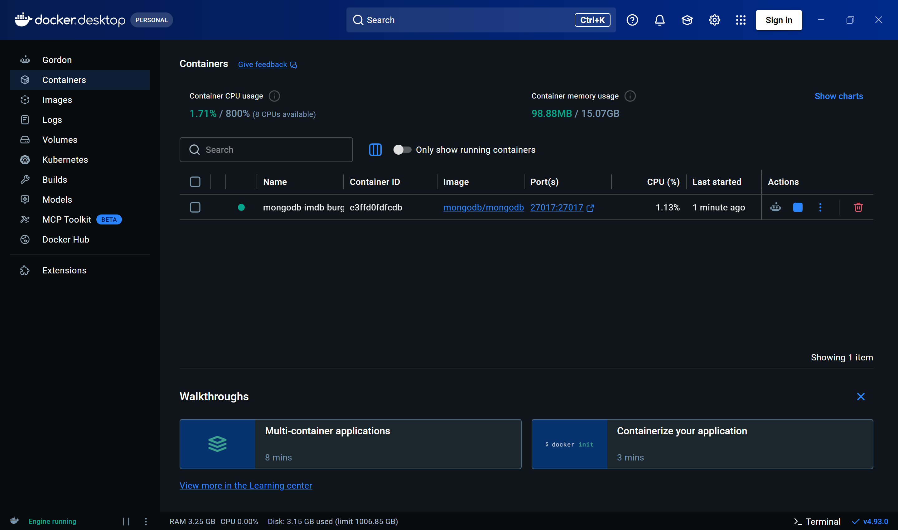

*Figura 1. MongoDB en Docker Desktop: contenedor activo y puerto 27017 publicado. Captura del 20 de octubre de 2026.*

### 1.2. Conexión desde MongoDB Compass

Se agregó una conexión con la URI `mongodb://127.0.0.1:27017`, utilizando el nombre **IMDb local - Docker**. La conexión permite acceder desde Compass al servidor MongoDB que se está ejecutando en el contenedor local.

La captura muestra la conexión activa con indicador verde y las bases del sistema `admin`, `config` y `local`. En esta etapa todavía no se había creado la base del práctico ni importado los archivos de IMDb.

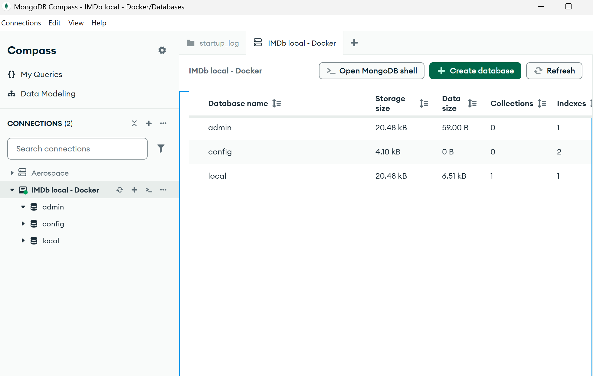

*Figura 2. Compass conectado a IMDb local - Docker, con las bases del sistema disponibles.*

### 1.3. Preparación de los archivos de IMDb

Se descargaron los tres archivos completos de IMDb y se convirtieron de TSV comprimido a JSON con un documento por línea, para poder importarlos desde Compass. Se conservaron todos los registros y los identificadores originales; se normalizaron los campos numéricos, los arrays y los valores ausentes antes de la carga.

El procedimiento reproducible, los recuentos de origen y los hashes de las fuentes se detallan en [Fuentes y preparación de los datos](datos/README.md).

La preparación se comprobó por separado de la carga en MongoDB. A continuación se registra cada importación con su recuento y su evidencia.

### 1.4. Importación de los títulos

Se creó la base `imdb_burghi_2026` y la colección `titulos`. Desde **Add Data → Import JSON or CSV file** se seleccionó `titulos.json`, generado a partir del archivo completo `title.basics.tsv.gz`.

Compass confirmó **Import completed: 12.881.680 documents imported**. El total coincide con los 12.881.680 registros de la fuente. La captura muestra también la base y colección utilizadas y documentos de ejemplo: `startYear` y `runtimeMinutes` aparecen como números, `endYear` como `null` cuando falta el dato y `genres` como array. El identificador original de IMDb se conserva en `_id`.


*Figura 3. Colección titulos con 12.881.680 documentos y confirmación de importación completada en MongoDB Compass.*

### 1.5. Importación de las valoraciones

Dentro de `imdb_burghi_2026` se creó la colección normal `ratings`, con la opción Time Series desactivada. Desde **Add Data → Import JSON or CSV file** se importó `ratings.json`, preparado a partir del archivo completo `title.ratings.tsv.gz`.

Compass confirmó **Import completed: 1.723.150 documents imported**, y el mismo total aparece en la navegación de documentos. El recuento coincide con el de la fuente. Los documentos muestran el identificador del título en `_id` y los campos numéricos `averageRating` y `numVotes`. Por ejemplo, para `tt0000001` se observa una valoración de `5.7` y `2237` votos.

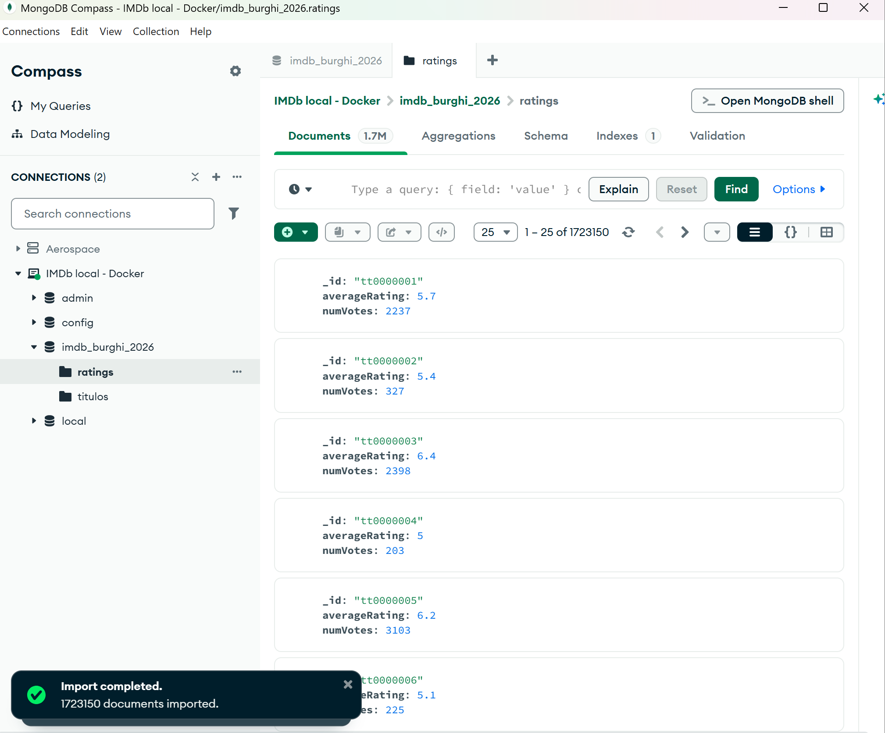

*Figura 4. Colección ratings con 1.723.150 documentos y confirmación de importación completada en MongoDB Compass, el 22 de octubre de 2026.*

### 1.6. Importación de las personas

Se creó la colección normal `personas` dentro de `imdb_burghi_2026`. Desde **Add Data → Import JSON or CSV file** se importó `personas.json`, preparado a partir del archivo completo `name.basics.tsv.gz`.

Compass confirmó **Import completed: 15.750.813 documents imported**, y el mismo total aparece en la navegación de documentos. La captura muestra las tres colecciones del práctico y documentos de ejemplo con `_id`, `primaryName`, `birthYear`, `deathYear`, `primaryProfession` y `knownForTitles`. Los años aparecen como números, y las profesiones y los títulos conocidos como arrays.


*Figura 5. Colección personas con 15.750.813 documentos y confirmación de importación completada en MongoDB Compass, el 22 de octubre de 2026.*

### 1.7. Modelo documental y justificación

Se eligió un modelo con tres colecciones, utilizando documentos independientes para los títulos, sus valoraciones y las personas. Las capturas de las importaciones muestran la estructura resultante.

| Colección | Identificador | Datos principales |
|---|---|---|
| `titulos` | `_id` conserva el `tconst` original | Tipo, título principal y original, indicador de contenido adulto, años, duración y array de géneros. |
| `ratings` | `_id` conserva el `tconst` original | Valoración promedio y cantidad de votos. |
| `personas` | `_id` conserva el `nconst` original | Nombre, años de nacimiento y fallecimiento, arrays de profesiones y títulos conocidos. |

**Relaciones y referencias.** El documento de `ratings` se relaciona con el título que tiene el mismo `_id`. Para este modelo, cada título puede tener cero o una valoración agregada: no todos aparecen en el archivo de valoraciones. Las entradas de `personas.knownForTitles` son identificadores de `titulos`. Una persona puede tener varios títulos conocidos y un título puede estar asociado a varias personas. Estas son referencias lógicas; no se configuraron restricciones de clave foránea.

`knownForTitles` solo contiene obras por las que una persona es conocida. No representa su filmografía completa ni permite reconstruir por sí solo el elenco o los roles de una película. Los créditos incorporados en el ejercicio 3 se verificaron con una fuente adicional, citada en la sección 4.

**Datos incluidos dentro del documento.** Los géneros y las profesiones se almacenaron como arrays porque son listas cortas que se consultan junto al título o la persona. No se crearon colecciones separadas para cada valor de esas listas.

**Datos en colecciones separadas.** Las personas se mantienen independientes para evitar repetir sus datos en cada título. Las valoraciones también se mantienen separadas para conservar la correspondencia con los tres archivos importados y permitir actualizar el promedio y los votos sin modificar los datos descriptivos del título. Las consultas solicitadas sobre títulos pueden ejecutarse directamente en `titulos`. Cuando se necesite mostrar la ficha junto con su valoración, se podrá relacionarlas mediante `$lookup`; esa operación todavía no se ejecutó como parte de esta entrega.

Embeber la valoración en el título sería una alternativa válida si se priorizara leer ambos datos juntos. La decisión utilizada aquí favorece la carga y actualización independiente de las fuentes; no se afirma que sea la opción más rápida para cualquier aplicación.

**Tipos y valores ausentes.** Los años y la duración se guardaron como números para poder comparar y ordenar sus valores. También son numéricos `averageRating`, `numVotes` e `isAdult` (se conserva 0/1). El marcador de ausencia `\N` se convirtió a `null` en campos escalares y a un array vacío en campos multivaluados. Los identificadores se conservan como cadenas. La preparación de los datos aplica estas reglas; no se configuró un validador de esquema en el servidor.

Se conservaron todos los tipos de título. En las consultas que pidan películas se usará `titleType: "movie"`; las comparaciones con `endYear` requieren explicar su uso en series.

El criterio de elegir entre datos embebidos y referencias se apoya en los conceptos de modelado de la presentación y en las [recomendaciones de modelado de MongoDB](https://www.mongodb.com/docs/manual/data-modeling/best-practices/). Las definiciones de los campos provienen de [IMDb](https://data.imdb.com/non-commercial-datasets/).

### Avance de la configuración

- [x] MongoDB funcionando en Docker.
- [x] Conexión desde MongoDB Compass.
- [x] Importación de `title.basics` en `titulos`: 12.881.680 documentos.
- [x] Importación de `title.ratings` en `ratings`: 1.723.150 documentos.
- [x] Importación de `name.basics` en `personas`: 15.750.813 documentos.
- [x] Modelo de documentos, tipos de datos y justificación.

## 2. Ejercicio 1: consultas

### 2.1. Buscar la película Fight Club

En la pestaña **Documents** de `imdb_burghi_2026.titulos` se ejecutó el siguiente filtro y se pulsó **Find**:

```javascript
{ titleType: "movie", primaryTitle: "Fight Club" }
```

El filtro exige que el tipo de título sea `movie` y que el título principal sea exactamente `Fight Club`, sin restringir el año.

La captura muestra dos documentos: `tt0137523`, con `startYear: 1999` y duración de 139 minutos, y `tt15561202`, con `startYear: 2023` y duración de 135 minutos. Ambos tienen `primaryTitle: "Fight Club"`. Esto permite observar que buscar solo por el nombre no identifica necesariamente una única película.

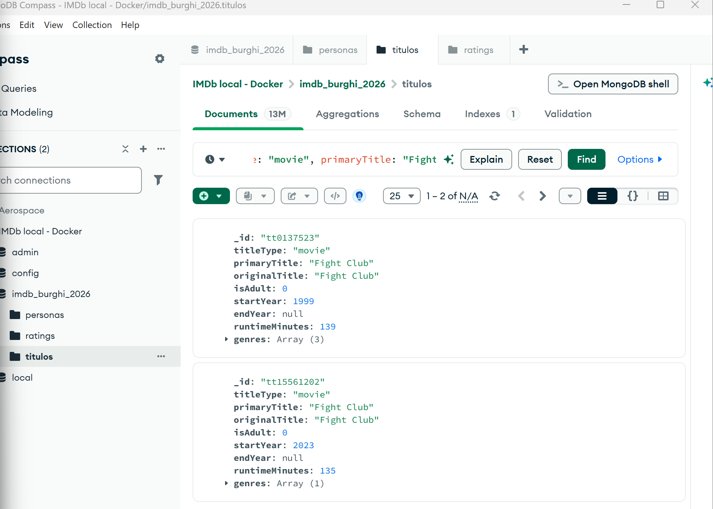

*Figura 6. Búsqueda de Fight Club: documentos de 1999 y 2023 visibles. La barra del filtro aparece parcialmente recortada y el contador total figura como N/A; los dos documentos mostrados son legibles.*

### 2.2. Buscar Fight Club de 1999

En la misma colección se agregó al filtro la condición `startYear: 1999`:

```javascript
{
  titleType: "movie",
  primaryTitle: "Fight Club",
  startYear: 1999
}
```

Las tres condiciones deben cumplirse simultáneamente. El año se compara como número. Compass mostró **un resultado** (`1–1 of 1`): el documento `tt0137523`, con título principal y original `Fight Club`, año de inicio `1999` y duración de `139` minutos. Así se distingue esta película del título homónimo de 2023 observado en la consulta anterior.

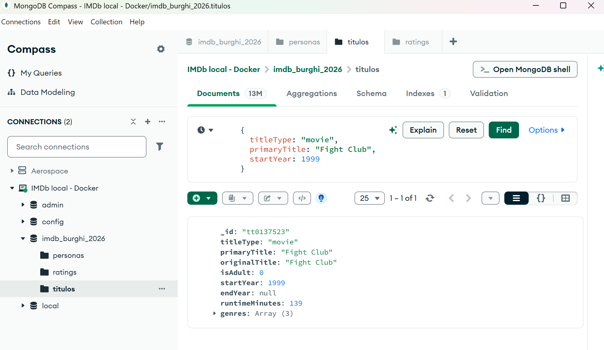

*Figura 7. Filtro completo por película, título y año, con un único resultado: Fight Club de 1999.*

### 2.3. Mostrar las películas de 1999

En `imdb_burghi_2026.titulos` se quitó la condición sobre el nombre y se ejecutó:

```javascript
{
  titleType: "movie",
  startYear: 1999
}
```

El filtro selecciona los títulos de tipo película cuyo año de inicio es 1999. No incluye series, episodios ni cortometrajes con otro `titleType`.

Compass mostró **5.154 resultados**, con la paginación `1–25 of 5154`. La captura incluye el filtro completo y parte del listado en vista de tabla. El conteo mediante agregación se ejecutó por separado en el ejercicio 2.

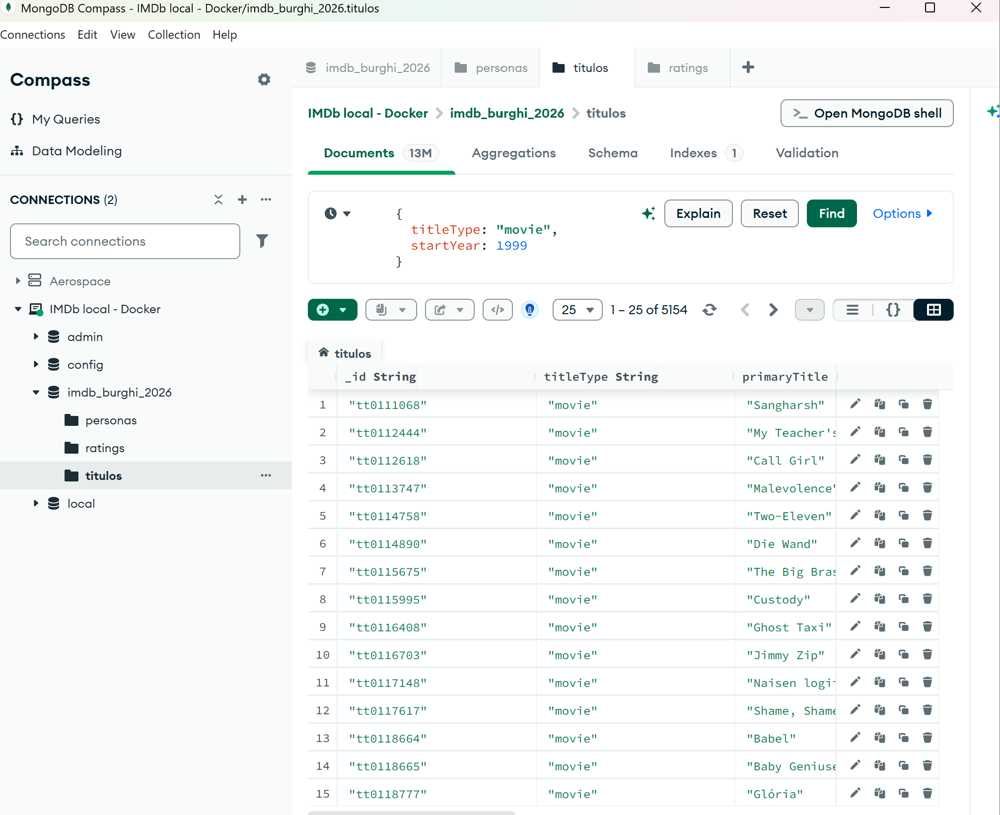

*Figura 8. Películas de 1999: filtro por tipo y año, listado de resultados y total de 5.154 documentos en Compass.*

### 2.4. Mostrar las películas posteriores a 1999

En la misma colección se ejecutó el siguiente filtro:

```javascript
{
  titleType: "movie",
  startYear: { $gt: 1999 }
}
```

El operador `$gt` selecciona valores estrictamente mayores que 1999. Por lo tanto, se incluyen las películas con `startYear` desde 2000, sin fijar un año máximo; las de 1999 quedan excluidas.

Compass mostró **388.352 resultados**, con la paginación `1–25 of 388352`. La captura permite verificar el filtro completo y el total del listado en vista de tabla.

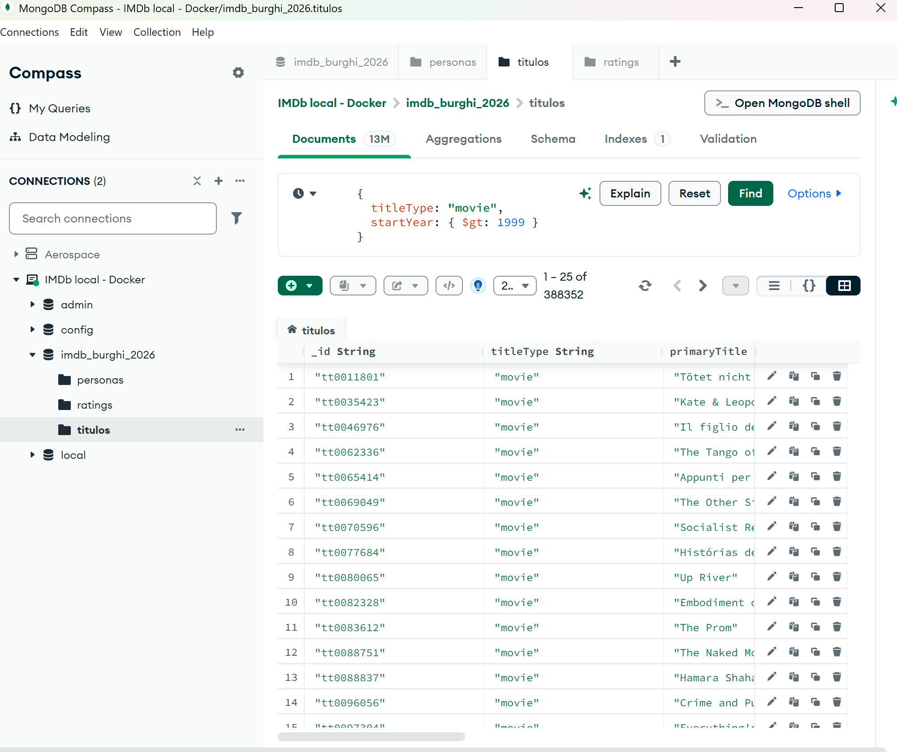

*Figura 9. Filtro de películas con startYear mayor que 1999 y total de 388.352 resultados.*

### 2.5. Consultar películas con un valor de endYear

Se interpretó primero el término «películas» de forma literal, manteniendo `titleType: "movie"`:

```javascript
{
  titleType: "movie",
  endYear: { $type: "number" }
}
```

Se utilizó `$type: "number"` para exigir un año numérico y excluir los valores `null` introducidos al normalizar los datos ausentes.

Compass devolvió **cero resultados**, con la paginación `0–0 of 0` y el mensaje **No results**. La ejecución es válida: [IMDb define endYear como el año de finalización de una serie](https://data.imdb.com/non-commercial-datasets/) y utiliza el marcador `\N` para los demás tipos de título. En nuestro modelo ese marcador se representa como `null`.

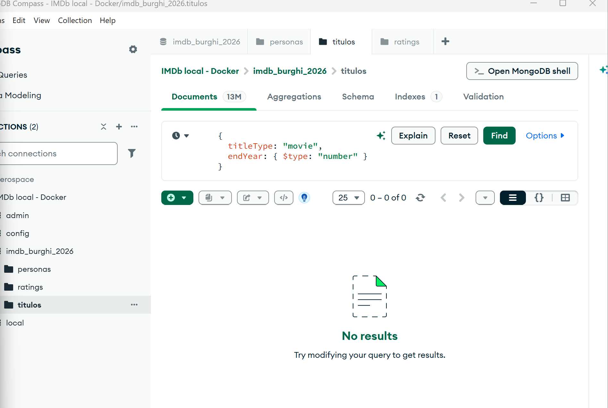

*Figura 10. Consulta literal sobre películas con endYear numérico: filtro completo, cero coincidencias y mensaje No results.*

### Comprobación complementaria sobre todos los tipos de título

Para observar los títulos que sí tienen un año de finalización se quitó la condición sobre `titleType` y se ejecutó:

```javascript
{
  endYear: { $type: "number" }
}
```

La ampliación se distingue de la consulta literal anterior: ahora se incluyen todos los tipos de título, entre ellos las series. Compass mostró **163.284 resultados**, con la paginación `1–25 of 163284`.

Entre los documentos visibles aparecen `tt0035599`, de tipo `tvSeries`, con `startYear: 1943` y `endYear: 1947`, y `tt0035803`, también `tvSeries`, con años 1940 y 1945. La captura permite comprobar que los datos de finalización están cargados y que la ausencia de resultados anterior correspondía a la restricción por películas.

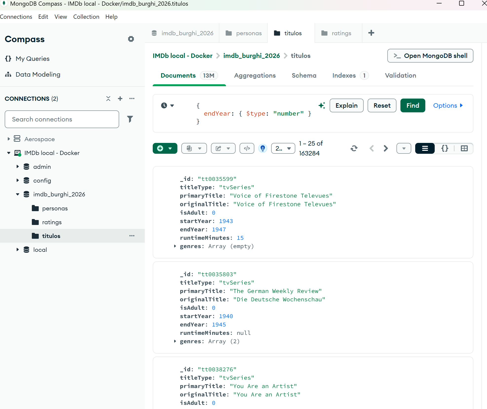

*Figura 11. Consulta complementaria sobre todos los tipos de título: 163.284 resultados y ejemplos de series con startYear y endYear informados.*

### 2.6. Comparar endYear con startYear

Se continuó con la interpretación sobre todos los tipos de título para incluir las series cuyos años de inicio y finalización están informados:

```javascript
{
  startYear: { $type: "number" },
  endYear: { $type: "number" },
  $expr: { $gt: ["$endYear", "$startYear"] }
}
```

Las dos primeras condiciones requieren valores numéricos. `$expr` permite comparar dos campos del mismo documento: `$gt` comprueba si `endYear` es estrictamente mayor que `startYear`.

Compass mostró **72.068 resultados**, con la paginación `1–25 of 72068`. Se observan, entre otros, los títulos `tt0035599` (1943–1947) y `tt0035803` (1940–1945), de tipo `tvSeries`, cuyos años cumplen la comparación.

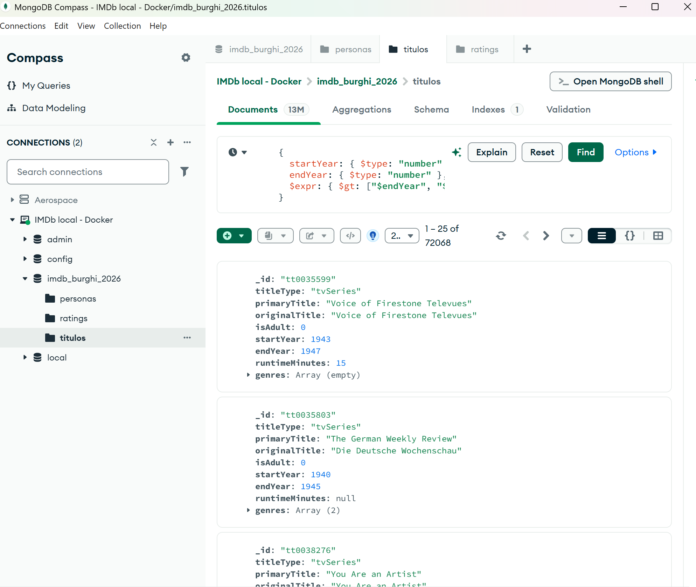

*Figura 12. Comparación endYear mayor que startYear: 72.068 resultados y documentos con ambos años visibles. El filtro completo utilizado se transcribe en esta sección.*

**Alcance de la interpretación.** La consigna utiliza el término «películas», pero el campo `endYear` corresponde a series en la fuente de IMDb. Por eso se mostró primero la consulta literal sobre `movie`, sin coincidencias, y luego las consultas sobre todos los tipos de título para demostrar el uso del campo y la comparación. Si a esta última consulta se agregara `titleType: "movie"`, necesariamente seguiría vacía: sería un subconjunto de la consulta sin resultados de la figura 10. Esta última afirmación es una deducción de esa evidencia; no se presenta como otra ejecución.

### Avance de las consultas

- [x] Buscar la película Fight Club.
- [x] Buscar Fight Club de 1999.
- [x] Mostrar las películas de 1999.
- [x] Mostrar las películas posteriores a 1999.
- [x] Consultar películas con un valor de `endYear`: cero resultados.
- [x] Comprobar `endYear` sobre todos los tipos de título: 163.284 resultados.
- [x] Comparar `endYear` con `startYear` sobre todos los tipos de título: 72.068 resultados.

La interpretación del término «películas» en las consultas de `endYear` se detalla en las secciones 2.5 y 2.6.

## 3. Ejercicio 2: agregaciones

### 3.1. Ordenar por startYear los títulos cuyo endYear es mayor que startYear

En `imdb_burghi_2026.titulos` se abrió **Aggregations**, se seleccionó el modo de texto y se ejecutó el siguiente pipeline con **Run**:

```javascript
[
  {
    $match: {
      startYear: { $type: "number" },
      endYear: { $type: "number" },
      $expr: { $gt: ["$endYear", "$startYear"] }
    }
  },
  { $sort: { startYear: 1, _id: 1 } }
]
```

`$match` conserva los títulos con ambos años numéricos y año final mayor que el inicial. Se mantiene la interpretación sobre todos los tipos de título explicada en el ejercicio 1. `$sort` ordena por `startYear` ascendente; `_id` se utiliza como segundo criterio para desempatar los títulos del mismo año.

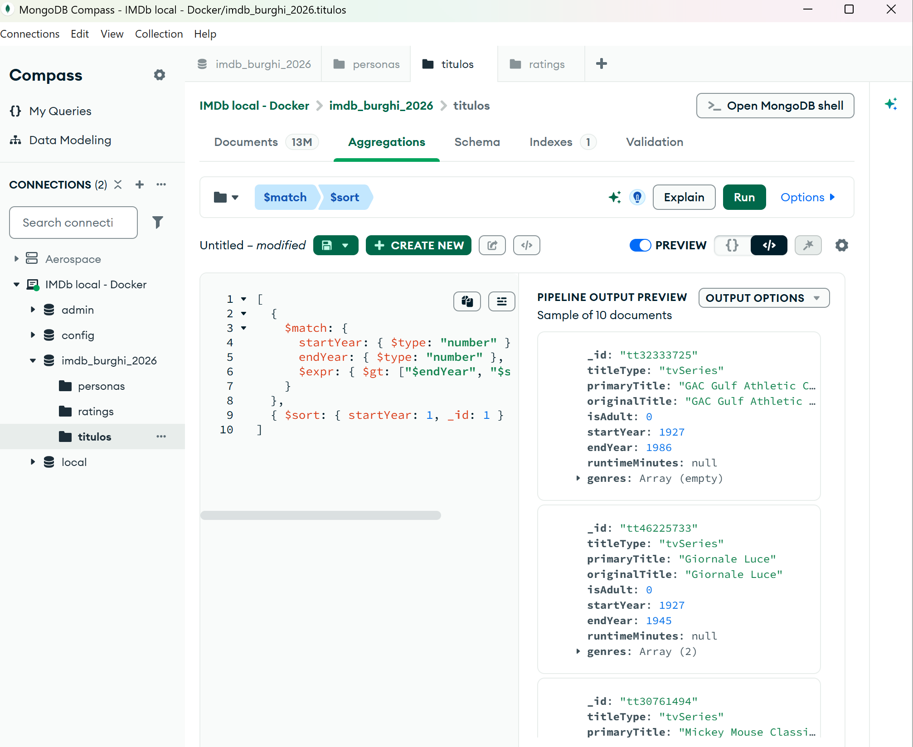

*Figura 13a. Editor de la agregación con las etapas match y sort, y vista previa de los documentos.*

En la vista de resultados de la ejecución se observan, en este orden:

| Título | startYear | endYear |
|---|---:|---:|
| GAC Gulf Athletic Club | 1927 | 1986 |
| Giornale Luce | 1927 | 1945 |
| Mickey Mouse Classic Shorts | 1928 | 2013 |

Los años iniciales visibles están ordenados de menor a mayor y, en cada documento, el año final es mayor que el inicial. La interfaz muestra los primeros resultados; no se calculó un total adicional desde la opción **count results** de esta agregación.

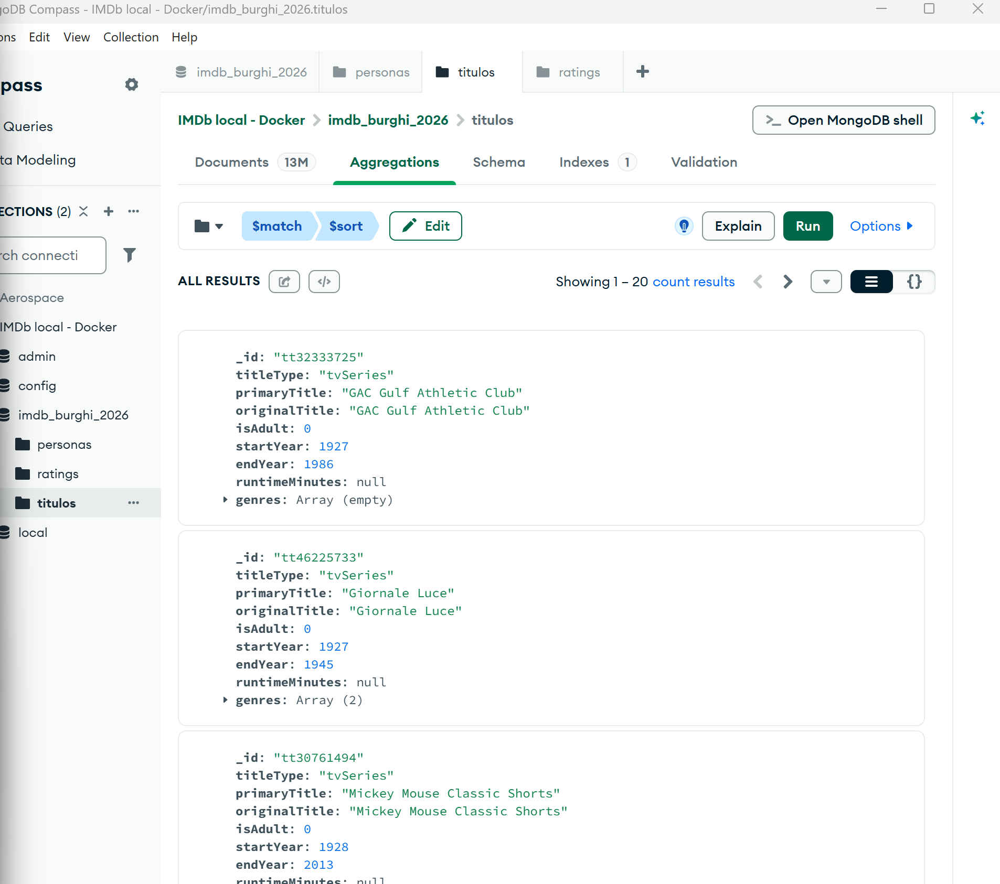

*Figura 13b. Resultados de la agregación: años de inicio 1927, 1927 y 1928, en orden ascendente.*

### 3.2. Contar las películas de 1999

En el editor de agregaciones de `titulos` se utilizó:

```javascript
[
  {
    $match: {
      titleType: "movie",
      startYear: 1999
    }
  },
  { $count: "cantidadPeliculas1999" }
]
```

`$match` selecciona las películas de 1999 y `$count` devuelve el número de documentos que cumplen el filtro. El panel de salida muestra un documento con el resultado:

```javascript
{ cantidadPeliculas1999: 5154 }
```

La agregación confirma **5.154 películas**, coincidiendo con el total observado en la consulta del ejercicio 1.

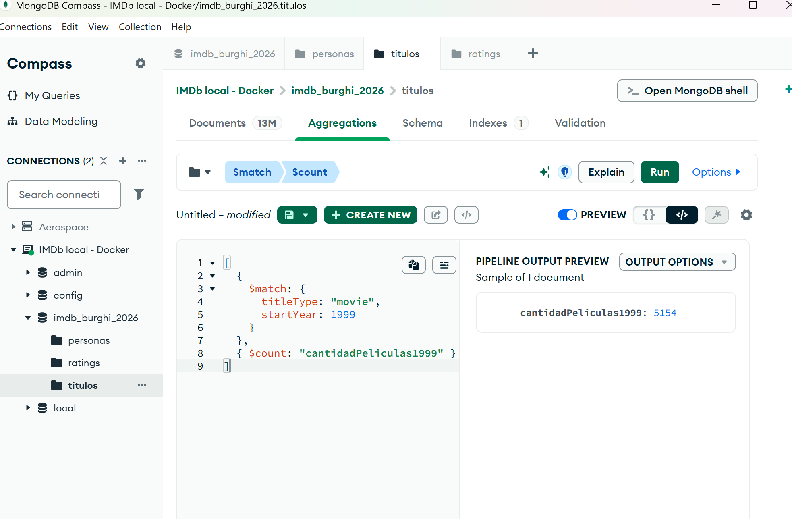

*Figura 14. Pipeline match y count, con el resultado cantidadPeliculas1999: 5154 visible en el panel de salida de Compass.*

### 3.3. Contar las películas de género Western

En la colección `titulos` se utilizó:

```javascript
[
  { $match: { titleType: "movie", genres: "Western" } },
  { $count: "cantidadWesterns" }
]
```

La igualdad sobre `genres` selecciona los documentos cuyo array contiene `"Western"`, aunque tengan también otros géneros. El panel de salida de Compass muestra:

```javascript
{ cantidadWesterns: 8185 }
```

Se obtuvieron **8.185 películas de género Western**.

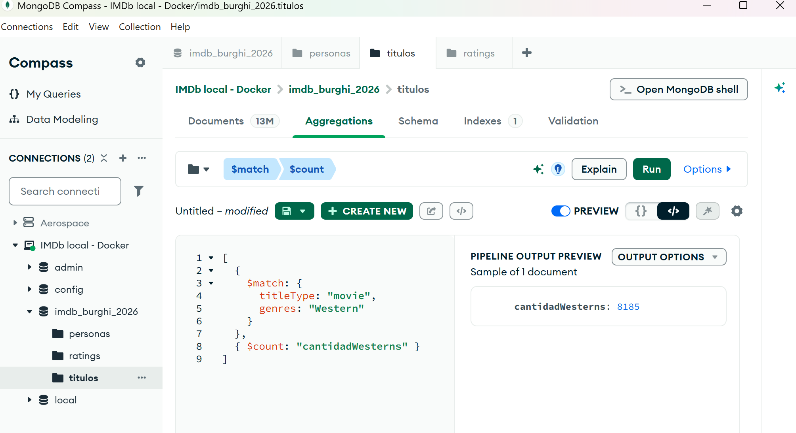

*Figura 15. Pipeline completo y resultado cantidadWesterns: 8185 en el panel de salida de Compass.*

### 3.4. Generar un array con los títulos de los westerns

Se ejecutó el siguiente pipeline sobre `titulos`:

```javascript
[
  { $match: { titleType: "movie", genres: "Western" } },
  { $sort: { primaryTitle: 1, _id: 1 } },
  { $group: { _id: null, titulos: { $push: "$primaryTitle" } } },
  { $project: { _id: 0, cantidad: { $size: "$titulos" }, titulos: 1 } }
]
```

Se agrupan todas las películas seleccionadas en un único documento y se acumula su título principal con `$push`. Se conserva una entrada por película, incluso si dos películas comparten el mismo nombre. El orden se establece antes de agrupar.

Compass muestra `titulos: Array (8185)` y `cantidad: 8185`, coincidiendo con el conteo del punto anterior. El array aparece contraído en la captura.

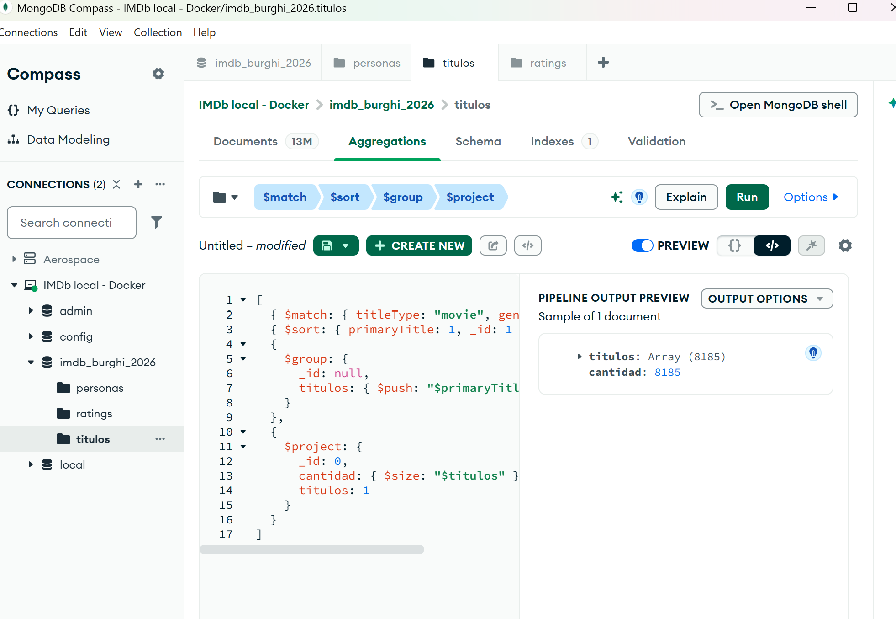

*Figura 16. Documento resultante con un array de 8.185 títulos y comprobación de su longitud.*

### 3.5. Listar los títulos de los westerns agrupados por género

```javascript
[
  { $match: { titleType: "movie", genres: "Western" } },
  { $unwind: "$genres" },
  { $sort: { genres: 1, primaryTitle: 1, _id: 1 } },
  {
    $group: {
      _id: "$genres",
      cantidad: { $sum: 1 },
      titulos: { $push: "$primaryTitle" }
    }
  },
  { $sort: { _id: 1 } },
  { $project: { _id: 0, genero: "$_id", cantidad: 1, titulos: 1 } }
]
```

**Criterio de agrupación:** primero se seleccionan exclusivamente películas cuyo array contiene Western. Luego `$unwind` separa los géneros de cada película, de modo que un western que también es Drama aparece tanto en el grupo Western como en Drama. Cada resultado contiene el género, la cantidad de películas y un array con sus títulos. Los grupos se ordenan por género y sus títulos por nombre.

La salida visible de Compass incluye:

| Género asociado a las películas Western | Cantidad | Longitud del array visible |
|---|---:|---:|
| Action | 505 | 505 |
| Adult | 26 | 26 |
| Adventure | 339 | 339 |
| Animation | 7 | 7 |
| Biography | 25 | 25 |

La captura muestra una vista previa de diez documentos; la tabla transcribe únicamente los cinco grupos legibles. Los arrays están contraídos. Como una película puede tener varios géneros, sumar las cantidades de todos los grupos contaría algunas películas más de una vez.

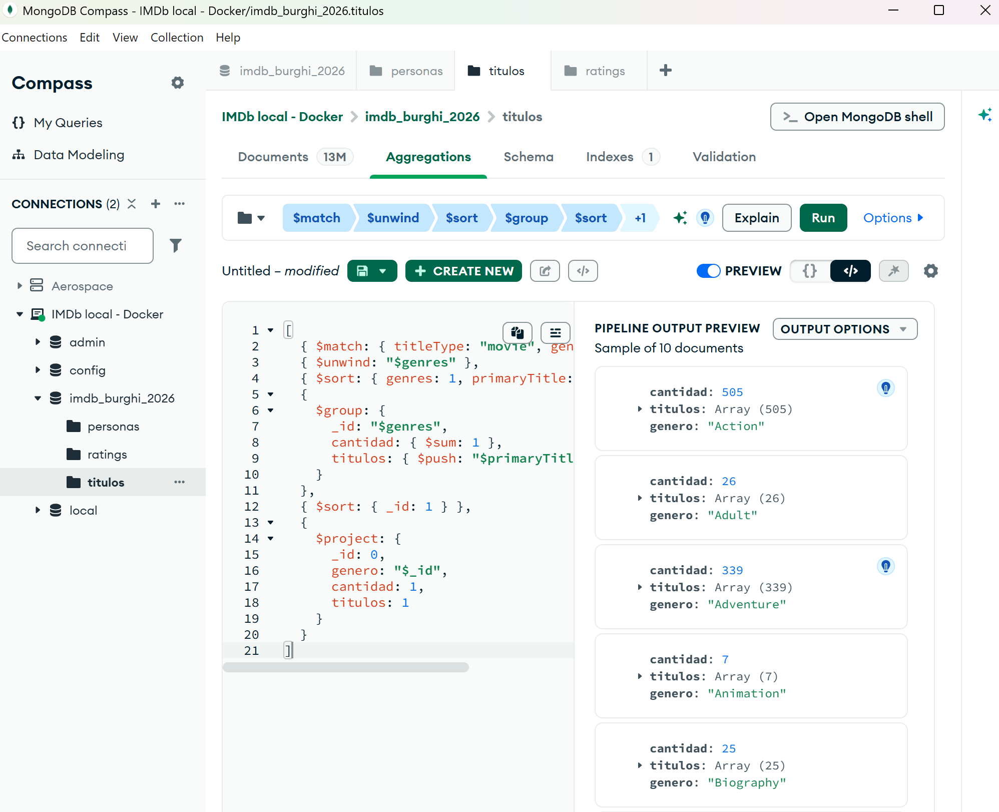

*Figura 17. Agrupación por cada género asociado a los westerns, con cantidad y array de títulos por grupo.*

### Avance de las agregaciones

- [x] Ordenar por `startYear` los títulos cuyo `endYear` sea mayor que `startYear`.
- [x] Contar las películas de 1999: 5.154.
- [x] Contar las películas de género Western: 8.185.
- [x] Generar un array con los títulos de los westerns: 8.185 elementos.
- [x] Agrupar los títulos de los westerns por género, explicitando el criterio utilizado.

## 4. Ejercicio 3: modificaciones

### 4.1. Agregar género y créditos a Fight Club de 1999

Se reutilizó la identificación obtenida en el ejercicio 1: `tt0137523`. En la shell de Compass se ejecutó una única actualización:

```javascript
db.getSiblingDB("imdb_burghi_2026").titulos.updateOne(
  {
    _id: "tt0137523",
    primaryTitle: "Fight Club",
    startYear: 1999
  },
  {
    $addToSet: { genres: "Comedia oscura" },
    $set: {
      equipo: {
        director: "David Fincher",
        directorFotografia: "Jeff Cronenweth",
        produccion: {
          productores: ["Art Linson", "Ceán Chaffin", "Ross Grayson Bell"],
          productoras: ["Fox 2000 Pictures", "New Regency Productions"]
        },
        elencoPrincipal: [
          "Brad Pitt", "Edward Norton", "Helena Bonham Carter",
          "Meat Loaf", "Jared Leto"
        ]
      }
    }
  }
);
```

La respuesta observada fue `acknowledged: true`, `matchedCount: 1` y `modifiedCount: 1`. Se modificó una película existente.

`$addToSet` añade la etiqueta sin borrar los géneros anteriores ni repetirla si ya existe. `$set` incorpora el subdocumento `equipo`. Se incluyen el director, el director de fotografía, productores, productoras y una selección del elenco principal; no se presenta como el reparto completo. Los créditos se verificaron en el [catálogo del American Film Institute](https://catalog.afi.com/Catalog/moviedetails/61148), consultado el 22 de octubre de 2026.

Se verificó el documento guardado con:

```javascript
db.getSiblingDB("imdb_burghi_2026").titulos.findOne(
  { _id: "tt0137523" },
  { _id: 1, primaryTitle: 1, startYear: 1, genres: 1, equipo: 1 }
);
```

La consulta devuelve Fight Club de 1999, con los géneros `Crime`, `Drama`, `Thriller` y `Comedia oscura`, y los créditos indicados. El equipo se embebe porque es información breve que se consulta con la ficha; no modifica los documentos de `personas` ni establece referencias nuevas a ellos.

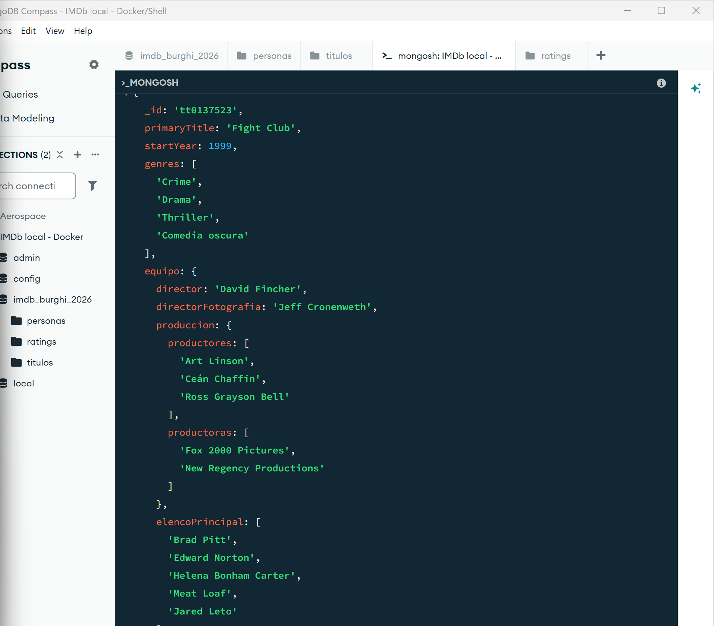

*Figura 18. Documento persistido de Fight Club de 1999: género Comedia oscura y equipo incorporado.*

### 4.2. Insertar Shrek 5 y consultar el documento

Se ejecutó:

```javascript
db.getSiblingDB("imdb_burghi_2026").titulos.insertOne({
  _id: "local:burghi:shrek5:2026",
  titleType: "movie",
  primaryTitle: "Shrek 5",
  originalTitle: "Shrek 5",
  isAdult: 0,
  startYear: 2026,
  endYear: null,
  runtimeMinutes: null,
  genres: ["Drama", "Short"]
});

db.getSiblingDB("imdb_burghi_2026").titulos.findOne({
  _id: "local:burghi:shrek5:2026"
});
```

Se respetan el año 2026 y los géneros Drama y Short indicados en la consigna. El valor `\\N` de `endYear` se representa como `null`, igual que en la importación, y `runtimeMinutes` queda en `null` porque la consigna no proporciona una duración. Los géneros se guardan en un array, manteniendo el modelo.

El identificador `local:burghi:shrek5:2026` pertenece al práctico y no se presenta como un identificador oficial de IMDb. Permite distinguir esta inserción de cualquier título de la fuente que tenga el mismo nombre.

La consulta posterior devuelve el documento con todos los valores insertados, incluidos el identificador propio, los dos títulos, `isAdult: 0`, `startYear: 2026`, los dos campos nulos y el array de géneros.

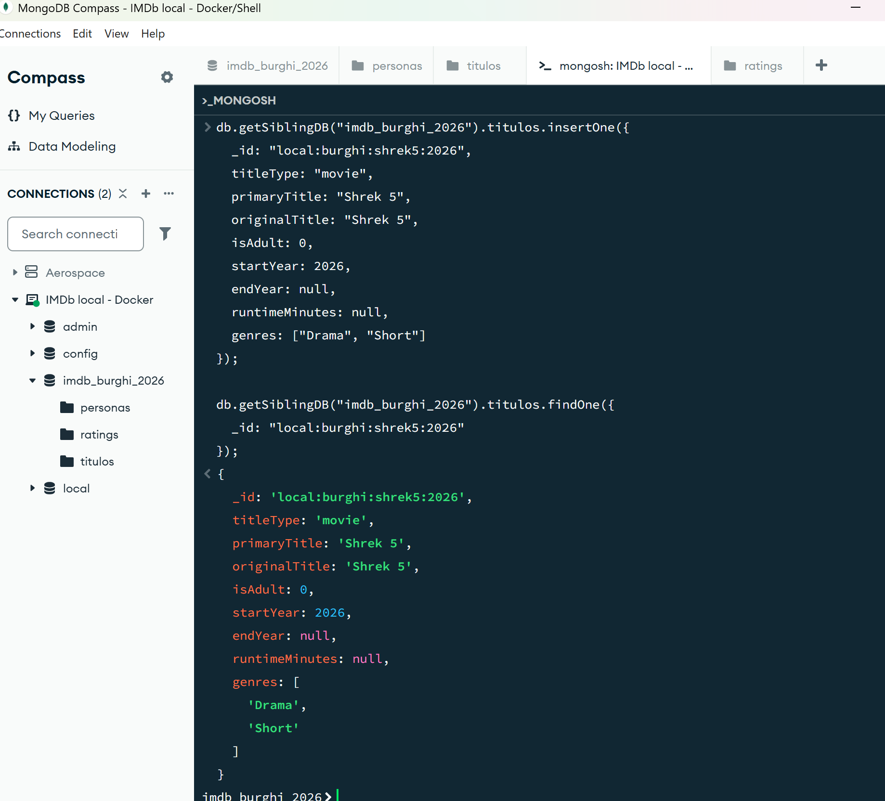

*Figura 19. Inserción y consulta posterior de Shrek 5 con los valores solicitados por la consigna.*

### Avance de las modificaciones

- [x] Localizar Fight Club de 1999.
- [x] Agregar la etiqueta de género «Comedia oscura», conservando las anteriores.
- [x] Incorporar director, director de fotografía, producción y elenco principal, con fuente de los créditos.
- [x] Insertar Shrek 5 con los valores de la consigna y explicar los datos ausentes.
- [x] Consultar los documentos resultantes para verificar las modificaciones.

## Evidencias

Las capturas se conservan en [`evidencias/`](evidencias/README.md). Se incorporan al documento junto al paso que demuestran, con numeración y una explicación breve. Las consultas y sus resultados se documentan con código, explicación e imágenes; los resultados vacíos también se documentarán cuando correspondan.

## Fuentes

- Presentación de clase: «Clase 4 - 5 - NoSQL 2026», páginas 102, 103 y 105.
- Consigna de entrega: «Ejercicio MongoDB (1 al 3)» y aviso del docente del 14 de octubre de 2026.
- [IMDb Non-Commercial Datasets](https://data.imdb.com/non-commercial-datasets/).
- [AFI: Fight Club (1999)](https://catalog.afi.com/Catalog/moviedetails/61148), para los créditos del ejercicio 3.
